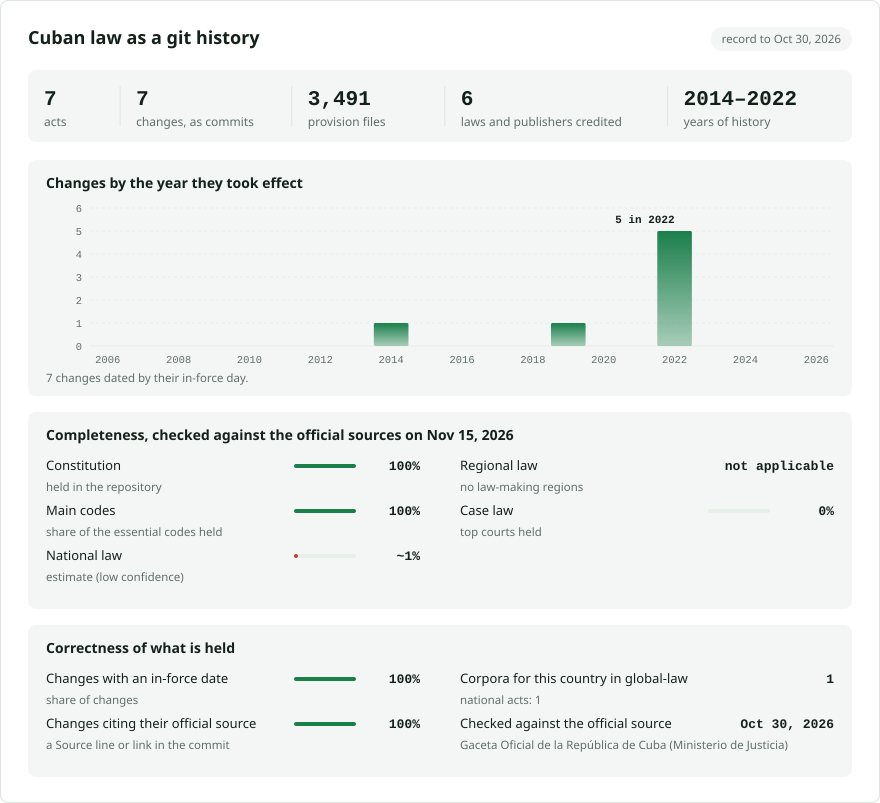

# Cuba: law history in git

[Español](README.md) · **English**

<picture>
<source media="(prefers-color-scheme: dark)" srcset="data/effort-dark.svg">

</picture>

The law of Cuba as a git history: one file per article, one commit per version on the day it took effect, and the law that made each change as the commit's author. `git blame` names the law behind every article; `git log` lists every change to an article; picking a date gives the text in force that day.

Part of [lexifina/global-law](https://github.com/lexifina/global-law), one git history for every country's law: this is Cuba's national law, which global-law reads at `cuba/national/acts/`.

**What is in it now:** the Constitution of 2019 and six codes and laws (the Código Civil, the Código Penal, the Código de las Familias, the Código de Procesos, the Ley del Proceso Penal and the Código de Trabajo), each in one version, with 3,484 provisions in all. [`data/versions.json`](data/versions.json) lists every act with its versions; [`data/laws.csv`](data/laws.csv) lists the six laws the record names.

Each act is a folder named after it (`constitucion/`, `codigo-penal/`, `codigo-de-trabajo/`), with one file per article: `codigo-de-trabajo/art-001.md` is Artículo 1 of the Código de Trabajo, Ley No. 116/2013. The preamble and each special, transitional and final provision have files of their own (`preambulo.md`, `dis-final-01.md`), and each folder's `README.md` lists its provisions.

The text is in Spanish, as the Gaceta Oficial prints it. An English translation is not part of this record.

## Questions as git commands

| Question | Command |
| --- | --- |
| Every change to Article 1 of the Código de Trabajo | `git log -p --word-diff -- codigo-de-trabajo/art-001.md` |
| Which act wrote each line of Article 1? | `git blame codigo-de-trabajo/art-001.md` |
| Every version of the Código de Trabajo, with the day each took effect | `git log --format="%h %(trailers:key=In-force,valueonly,separator=) %an" -- codigo-de-trabajo ":(exclude)codigo-de-trabajo/README.md"` |
| Article 1 as in force on 1 January 2020 | `python tools/on.py 2020-01-01 codigo-de-trabajo art-001` |

**Outside git**, we also host this record publicly, for free:

- **[Ask Claude about Cuban law](https://global-law.lexifina.com/v1/try_claude?country=cuba)**: opens Claude with a first question ready.
- **[Ask ChatGPT](https://global-law.lexifina.com/v1/try_chatgpt?country=cuba)**: the same question in ChatGPT.
- **[Search Cuban law on our site](https://lexifina.com/law?country=cuba&q=vacaciones+anuales)**: a search for "vacaciones anuales", with each provision's text and its versions, no account needed.
- **[Developer REST API](https://global-law.lexifina.com/v1/search_law?query=vacaciones+anuales&jurisdiction=cuba)**: the same search as JSON, with no key. See the [documentation here](https://lexifina.com/api/global-law).

Both assistants read the record through the free Global law connector (MCP, `https://global-law.lexifina.com/mcp`); the first time, the chat gives you the link that adds it. Ask in Spanish or in English.

**Host it yourself easily.** All it takes is git and Python, and the tools run on your machine:

```sh
git clone --depth 1 https://github.com/lexifina/global-law && cd global-law
python3 tools/countries.py add cuba/national/acts
python3 tools/law.py show 2026-01-01 cuba/national/acts/codigo-de-trabajo/art-001.md
```

Opened in Claude Code, Cursor, VS Code or Codex, the clone also starts a local MCP server with the same tools ([MCP.md](https://github.com/lexifina/global-law/blob/main/MCP.md)).

## Dates

Each commit is dated at noon, America/Havana, on the day the version took effect, and carries it in its `In-force:` trailer:

- for an act as enacted, the day its final provisions put it in force: 1 December 2022 for the Código Penal (ninety days after its publication on 1 September 2022), 1 January 2022 for the Código de Procesos and the Ley del Proceso Penal, and 17 June 2014 for the Código de Trabajo, its publication, within the 180 days after approval that its final provision Sexta allows;
- for the Código de las Familias, 26 September 2022, the day its ratification by the referendum of 25 September was signed, as the Gaceta records;
- for the Constitution, its proclamation and publication on 10 April 2019; for the Código Civil, the date of the Gaceta Oficial's updated edition, 8 November 2022.

The five acts as enacted are credited to the law itself (`Ley No. 151/2022`). The Constitution and the Código Civil are the "oldest version available", credited to the publisher, the Gaceta Oficial de la República de Cuba (Ministerio de Justicia).

## How it is checked

- Each text is taken from the Gaceta's born-digital PDF: headings stay at the start of the article that follows them, page headers, enacting formulas and signatures are left out, and words split across lines are joined. `REPRODUCE.md` lists every decision made by hand.
- `tools/check_repo.py` reads every version back from git on the day it took effect and on the day before; both must match the corpus: 7 versions of 7 acts, 0 mismatches, and a second build gave identical hashes ([`REPRODUCE.md`](REPRODUCE.md)).
- No merge commits on `main`, no commit dates that go backwards, nothing dated after the build, and every commit's trailers parse. New versions go on top with `tools/append.py`, never by rewriting.

## What it does not show

- **Amendments.** Each act has one version, and later amendments are not replayed: the Gaceta publishes acts as passed, not consolidated texts. The Código Civil (Ley No. 59/1987) is its updated edition of 8 November 2022; earlier consolidated texts are not online.
- **Most national law.** Seven acts are here; other laws, decree-laws, decrees and resolutions are not, nor the Código de Trabajo's regulation (Decreto 326/2014, in the same Gaceta issue), nor the Constitution of 1976.
- **Case law, local acts, treaties and bills.**

## Sources

| Source | Kind | Past versions | Notes |
| --- | --- | --- | --- |
| [Gaceta Oficial de la República de Cuba](https://www.gacetaoficial.gob.cu) (Ministerio de Justicia) | Official gazette | no: acts as passed, and the Código Civil only as an updated edition | Born-digital PDFs: No. 29 Extraordinaria (2014), No. 5 Extraordinaria (2019), Nos. 138 and 140 Ordinaria (2021), Nos. 93 and 99 Ordinaria (2022), and the Código Civil's edition current to 8 November 2022 |

## Licence

See [`LICENSE`](LICENSE). The Gaceta Oficial's site states no licence; the official legal texts are reproduced for reference with attribution to the publisher. Lexifina's arrangement of this repository, its commit messages and tools may be reused under the Creative Commons Attribution 4.0 International licence.

No AI model wrote, translated or corrected legal text, and none runs at build time; the scripts were written by Claude Code running Claude Opus 5.5 (see [`REPRODUCE.md`](REPRODUCE.md)).

## More

From [lexifina/global-law](https://github.com/lexifina/global-law):

- [FEATURES.md](https://github.com/lexifina/global-law/blob/main/FEATURES.md): every feature, and what every corpus must support (`git blame`, `law.py`, the MCP tools)
- [FAQ.md](https://github.com/lexifina/global-law/blob/main/FAQ.md): questions and answers · [CONTRIBUTING.md](https://github.com/lexifina/global-law/blob/main/CONTRIBUTING.md): proposing changes · [MCP.md](https://github.com/lexifina/global-law/blob/main/MCP.md): the MCP server · [REPRODUCE.md](https://github.com/lexifina/global-law/blob/main/REPRODUCE.md): how it was built · [CHANGELOG.md](https://github.com/lexifina/global-law/blob/main/CHANGELOG.md)
- [FRESHNESS.md](https://github.com/lexifina/global-law/blob/main/FRESHNESS.md): how current each corpus is · [Monitoring](https://github.com/lexifina/global-law/tree/main/monitoring): whether updates are running · [WATCHING.md](https://github.com/lexifina/global-law/blob/main/WATCHING.md): how each official source is watched for changes
- [performance/](https://github.com/lexifina/global-law/tree/main/performance): how fast the tools are, measured
- [visualisations/](https://github.com/lexifina/global-law/tree/main/visualisations): charts and bridges across the world's law
- [Vulnerabilities](https://github.com/lexifina/global-law/tree/main/vulnerabilities): mistakes in legislation as published
