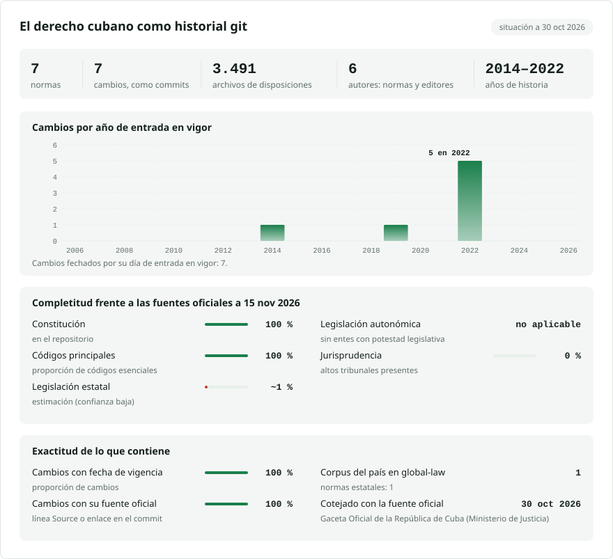

# Cuba: historia del derecho en git

**Español** · [English](README.en.md)

<picture>
<source media="(prefers-color-scheme: dark)" srcset="data/es/effort-dark.svg">

</picture>

El derecho de Cuba como historia de git: un archivo por artículo, un commit por versión el día en que entró en vigor, y la ley que hizo cada cambio como autor del commit. `git blame` indica la ley que está detrás de cada artículo; `git log` enumera todos los cambios de un artículo; al elegir una fecha se obtiene el texto vigente ese día.

Forma parte de [lexifina/global-law](https://github.com/lexifina/global-law), una única historia de git para el derecho de todos los países: este es el derecho nacional de Cuba, que global-law lee en `cuba/national/acts/`.

**Qué contiene ahora:** la Constitución de 2019 y seis códigos y leyes (el Código Civil, el Código Penal, el Código de las Familias, el Código de Procesos, la Ley del Proceso Penal y el Código de Trabajo), cada uno en una versión, con 3484 disposiciones en total. [`data/versions.json`](data/versions.json) enumera cada norma con sus versiones; [`data/laws.csv`](data/laws.csv) enumera las seis leyes que el registro menciona.

Cada norma es una carpeta con su nombre (`constitucion/`, `codigo-penal/`, `codigo-de-trabajo/`), con un archivo por artículo: `codigo-de-trabajo/art-001.md` es el Artículo 1 del Código de Trabajo, Ley No. 116/2013. El preámbulo y cada disposición especial, transitoria y final tienen su propio archivo (`preambulo.md`, `dis-final-01.md`), y el `README.md` de cada carpeta enumera sus disposiciones.

El texto está en español, tal como lo publica la Gaceta Oficial. Este registro no incluye una traducción al inglés.

## Preguntas como comandos de git

| Pregunta | Comando |
| --- | --- |
| Todos los cambios del Artículo 1 del Código de Trabajo | `git log -p --word-diff -- codigo-de-trabajo/art-001.md` |
| ¿Qué norma escribió cada línea del Artículo 1? | `git blame codigo-de-trabajo/art-001.md` |
| Todas las versiones del Código de Trabajo, con el día en que entró en vigor cada una | `git log --format="%h %(trailers:key=In-force,valueonly,separator=) %an" -- codigo-de-trabajo ":(exclude)codigo-de-trabajo/README.md"` |
| El Artículo 1 vigente al 1 de enero de 2020 | `python tools/on.py 2020-01-01 codigo-de-trabajo art-001` |

**Fuera de git**, también alojamos este registro de forma pública y gratuita:

- **[Preguntar a Claude sobre el derecho cubano](https://global-law.lexifina.com/v1/try_claude?country=cuba)**: abre Claude con una primera pregunta preparada.
- **[Preguntar a ChatGPT](https://global-law.lexifina.com/v1/try_chatgpt?country=cuba)**: la misma pregunta en ChatGPT.
- **[Buscar en el derecho cubano en nuestro sitio](https://lexifina.com/law?country=cuba&q=vacaciones+anuales)**: una búsqueda de "vacaciones anuales", con el texto de cada disposición y sus versiones, sin necesidad de cuenta.
- **[API REST para desarrolladores](https://global-law.lexifina.com/v1/search_law?query=vacaciones+anuales&jurisdiction=cuba)**: la misma búsqueda en JSON, sin clave. Consulte la [documentación aquí](https://lexifina.com/api/global-law).

Ambos asistentes leen el registro a través del conector gratuito Global law (MCP, `https://global-law.lexifina.com/mcp`); la primera vez, el chat le da el enlace para agregarlo. Pregunte en español o en inglés.

**Alójelo usted mismo fácilmente.** Solo hacen falta git y Python, y las herramientas se ejecutan en su equipo:

```sh
git clone --depth 1 https://github.com/lexifina/global-law && cd global-law
python3 tools/countries.py add cuba/national/acts
python3 tools/law.py show 2026-01-01 cuba/national/acts/codigo-de-trabajo/art-001.md
```

Abierto en Claude Code, Cursor, VS Code o Codex, el clon también inicia un servidor MCP local con las mismas herramientas ([MCP.md](https://github.com/lexifina/global-law/blob/main/MCP.md)).

## Fechas

Cada commit está fechado a las doce del mediodía, hora de America/Havana, del día en que la versión entró en vigor, y lleva ese día en su trailer `In-force:`:

- para una norma tal como se aprobó, el día en que sus disposiciones finales la pusieron en vigor: el 1 de diciembre de 2022 para el Código Penal (noventa días después de su publicación el 1 de septiembre de 2022), el 1 de enero de 2022 para el Código de Procesos y la Ley del Proceso Penal, y el 17 de junio de 2014 para el Código de Trabajo, día de su publicación, dentro de los 180 días posteriores a su aprobación que permite su Disposición Final Sexta;
- para el Código de las Familias, el 26 de septiembre de 2022, día en que se firmó su ratificación en el referendo del 25 de septiembre, según consta en la Gaceta;
- para la Constitución, su proclamación y publicación el 10 de abril de 2019; para el Código Civil, la fecha de la edición actualizada de la Gaceta Oficial, el 8 de noviembre de 2022.

Las cinco normas tal como se aprobaron se atribuyen a la propia ley (`Ley No. 151/2022`). La Constitución y el Código Civil son la "versión más antigua disponible", atribuida a quien la publica, la Gaceta Oficial de la República de Cuba (Ministerio de Justicia).

## Cómo se verifica

- Cada texto se toma del PDF nativo digital de la Gaceta: los encabezados se mantienen al principio del artículo que les sigue, se omiten los encabezados de página, las fórmulas de promulgación y las firmas, y se unen las palabras divididas entre líneas. `REPRODUCE.md` enumera cada decisión tomada a mano.
- `tools/check_repo.py` vuelve a leer desde git cada versión el día en que entró en vigor y el día anterior; ambas lecturas deben coincidir con el corpus: 7 versiones de 7 normas, 0 discrepancias, y una segunda compilación dio hashes idénticos ([`REPRODUCE.md`](REPRODUCE.md)).
- No hay commits de fusión (merge) en `main`, ni fechas de commit que retrocedan, ni nada fechado después de la compilación, y los trailers de todos los commits se analizan sin errores. Las versiones nuevas se añaden encima con `tools/append.py`, nunca reescribiendo la historia.
- [vulnerabilities/](vulnerabilities/): posibles errores de redacción en este derecho, hallados por los detectores de global-law y revisados a mano. Aún no se ha ejecutado.

## Qué no muestra

- **Las modificaciones.** Cada norma tiene una versión, y las modificaciones posteriores no se reproducen: la Gaceta publica las normas tal como se aprobaron, no textos actualizados. El Código Civil (Ley No. 59/1987) es su edición actualizada del 8 de noviembre de 2022; los textos actualizados anteriores no están en línea.
- **La mayor parte del derecho nacional.** Aquí hay siete normas; no están las demás leyes, decretos-leyes, decretos y resoluciones, ni el reglamento del Código de Trabajo (Decreto 326/2014, en el mismo número de la Gaceta), ni la Constitución de 1976.
- **La jurisprudencia, las normas locales, los tratados y los proyectos de ley.**

## Fuentes

| Fuente | Tipo | Versiones anteriores | Notas |
| --- | --- | --- | --- |
| [Gaceta Oficial de la República de Cuba](https://www.gacetaoficial.gob.cu) (Ministerio de Justicia) | Gaceta oficial | no: las normas tal como se aprobaron, y el Código Civil solo como edición actualizada | PDF nativos digitales: No. 29 Extraordinaria (2014), No. 5 Extraordinaria (2019), Nos. 138 y 140 Ordinaria (2021), Nos. 93 y 99 Ordinaria (2022), y la edición del Código Civil actualizada al 8 de noviembre de 2022 |

## Licencia

Véase [`LICENSE`](LICENSE). El sitio de la Gaceta Oficial no indica ninguna licencia; los textos jurídicos oficiales se reproducen como referencia, con atribución a quien los publica. La organización de este repositorio por Lexifina, sus mensajes de commit y sus herramientas pueden reutilizarse conforme a la licencia Creative Commons Atribución 4.0 Internacional.

Ningún modelo de IA escribió, tradujo ni corrigió texto normativo, y ninguno se ejecuta durante la compilación; los scripts los escribió Claude Code con Claude Opus 5.5 (véase [`REPRODUCE.md`](REPRODUCE.md)).

Esta es una traducción de la versión inglesa ([README.en.md](README.en.md)); si difieren, prevalece la versión inglesa.

## Visualizaciones

- [visualisations/](visualisations/): gráficos hechos a partir de este repositorio. Aún no se han hecho.

## Más información

Del repositorio [lexifina/global-law](https://github.com/lexifina/global-law) (páginas en inglés):

- [FEATURES.md](https://github.com/lexifina/global-law/blob/main/FEATURES.md): todas las funciones y lo que cada corpus debe admitir (`git blame`, `law.py`, herramientas MCP)
- [FAQ.md](https://github.com/lexifina/global-law/blob/main/FAQ.md): preguntas y respuestas · [CONTRIBUTING.md](https://github.com/lexifina/global-law/blob/main/CONTRIBUTING.md): proponer cambios · [MCP.md](https://github.com/lexifina/global-law/blob/main/MCP.md): servidor MCP · [REPRODUCE.md](https://github.com/lexifina/global-law/blob/main/REPRODUCE.md): cómo se ha construido · [CHANGELOG.md](https://github.com/lexifina/global-law/blob/main/CHANGELOG.md)
- [FRESHNESS.md](https://github.com/lexifina/global-law/blob/main/FRESHNESS.md): lo actualizado que está cada corpus · [Supervisión](https://github.com/lexifina/global-law/tree/main/monitoring): si las actualizaciones funcionan · [WATCHING.md](https://github.com/lexifina/global-law/blob/main/WATCHING.md): cómo se vigila cada fuente oficial para detectar cambios
- [performance/](https://github.com/lexifina/global-law/tree/main/performance): la rapidez de las herramientas, medida
- [visualisations/](https://github.com/lexifina/global-law/tree/main/visualisations): gráficos y conexiones a través del derecho de todo el mundo
- [Vulnerabilidades](https://github.com/lexifina/global-law/tree/main/vulnerabilities): errores en las normas tal como se publicaron
